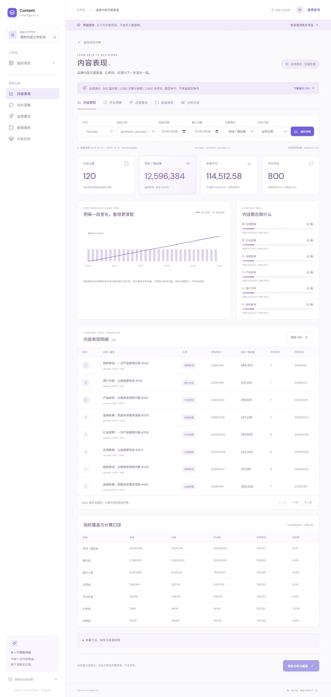
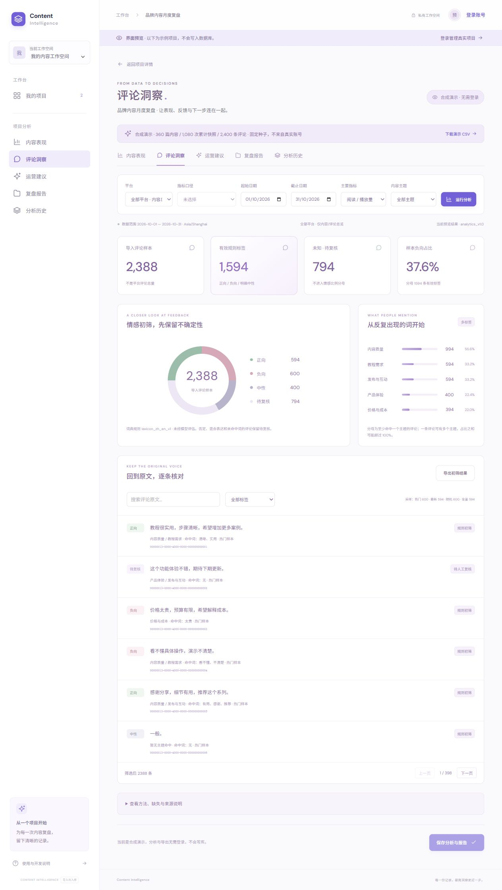
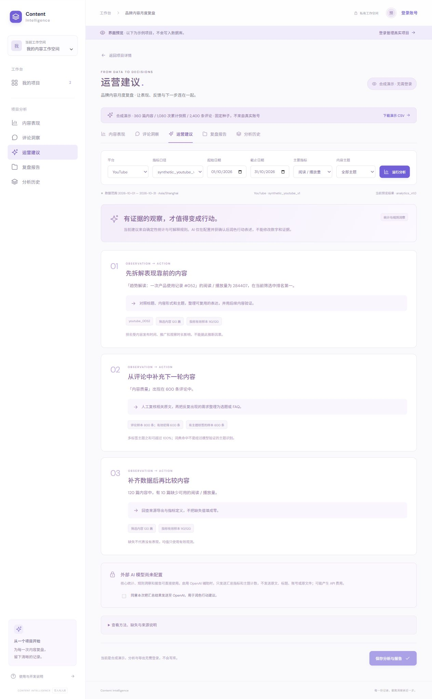
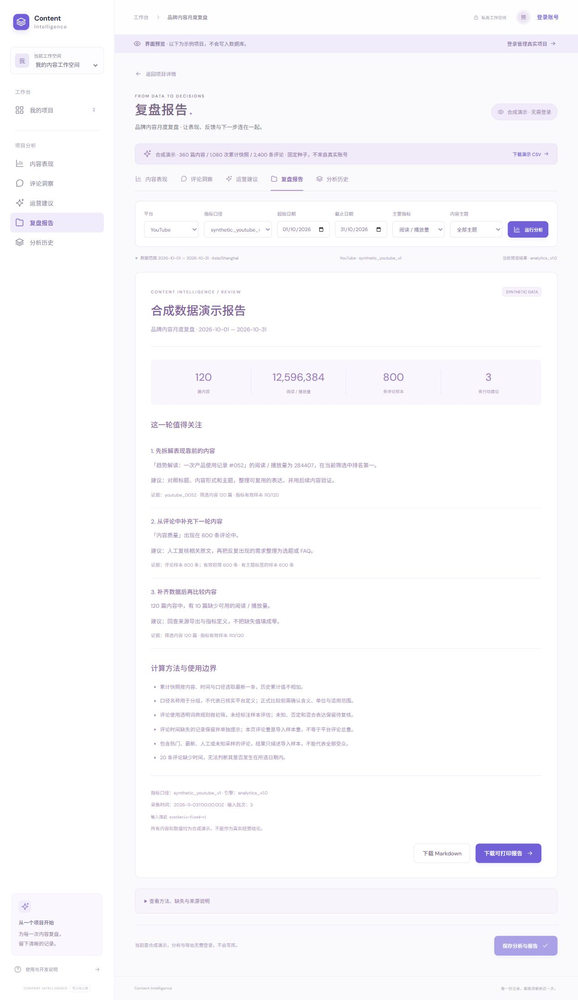
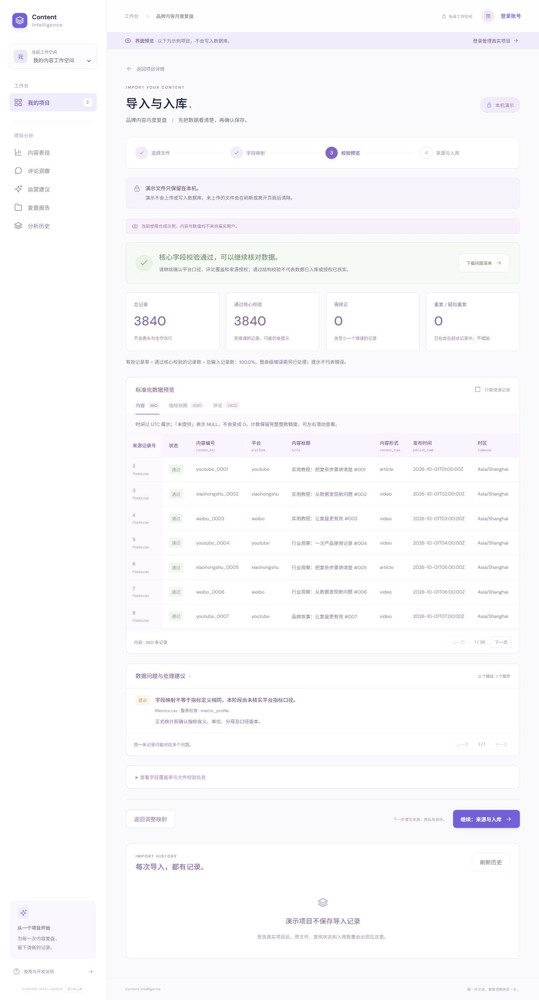
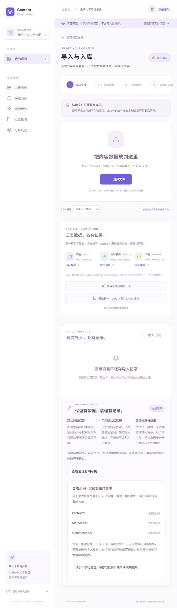

# Content Intelligence

从 CSV / Excel 导入，到内容统计、评论样本复核和有证据的复盘报告的中文工作台。

**可以先不注册、不登录，体验完整合成演示。** 真实账号的上传、保存和权限联调留到最终验收。

## 复杂数据演示与操作截图

固定种子生成 **360 篇内容、1,080 次累计快照、2,400 条评论**，覆盖 YouTube、小红书、微博，含缺失值、真实零值、多种采样和多次快照。所有标题、评论和数值都是合成数据，不对应真实品牌或经营成果。

以下图片直接截取本项目正式构建页面；点击图片可查看大图。

### 内容表现：筛选、累计快照、趋势、排名和缺失覆盖

[](docs/screenshots/performance.jpg)

| 评论洞察：分布、主题和原文复核 | 运营建议：观察、行动、证据和限制 |
| --- | --- |
| [](docs/screenshots/comments.jpg) | [](docs/screenshots/insights.jpg) |
| **复盘报告：来源、方法和导出** | **复杂导入：3,840 条记录的质量校验** |
| [](docs/screenshots/report.jpg) | [](docs/screenshots/import-quality.jpg) |

新增原文件管理，可在不登录的演示中展开清理影响；演示不执行删除。

[](docs/screenshots/original-lifecycle.jpg)

同一份演示源数据按筛选生成结果，例如单独选择 YouTube 后为 120 篇内容、800 条评论；全部平台评论还会按评论日期筛选，所以并非每张图都显示完整的 2,400 条。

## 已实现功能

| 模块 | 可以做什么 |
| --- | --- |
| 项目与账号 | 注册、登录、重置密码入口、工作空间、项目创建与切换 |
| 数据导入 | CSV / XLSX 读取、中英文字段映射、时间/计数/重复/关联校验、问题清单、复杂合成样本 |
| 私有入库 | 原文件保存、服务器重新读取并核对 SHA-256、整批事务、失败回滚、重复提交保护、导入历史 |
| 内容表现 | 平台/口径/日期/主题/指标筛选，最新累计快照，总量、均值、中位数、排名、趋势、有效样本与缺失率 |
| 评论洞察 | 可解释词典初筛、未知与混合表达保留、多标签主题、命中词、采样方式、原文搜索与 CSV 导出 |
| 运营建议 | 每条建议附统计观察、证据、行动和使用限制；可选外部 AI 只润色行动文字 |
| 报告与历史 | Markdown / 可打印 HTML，浏览器另存 PDF；真实项目保存输入快照、版本、结果和私有报告 |

评论模块当前是 **词典规则初筛，不是经过标注数据评估的机器学习模型**。外部 AI 默认关闭，需在服务端配置密钥与模型，并在页面明确确认本次调用；没有密钥也能使用统计、规则建议和报告。

## 本地快速体验

需要 Node.js 22.18+，开发环境为 Node.js 24。依赖已固定版本并提交锁定文件。

```sh
npm ci
npm run dev
```

打开终端打印的地址，再访问：

```text
http://127.0.0.1:3000/?preview=1&project=10000000-0000-4000-8000-000000000001&view=performance
```

也可在首页点击「浏览界面预览」，打开示例项目，通过左侧菜单切换内容表现、评论洞察、运营建议和报告。
在导入页点击「复杂样本：360 内容 / 2,400 评论」，可运行相同数据的映射和质量检查。演示不会写入真实数据库。

## 接入真实项目

1. 将 `.env.example` 复制为 `.env.local`，填写 Supabase 项目 URL 与 publishable key；文件不要提交。
2. 在空 Supabase 数据库按顺序执行 `supabase/migrations/` 的迁移。当前连接项目已经执行，**不要重复运行**。
3. 部署 `import-batch` 与 `analyze-project` Edge Functions，保持 JWT 验证；相对依赖列表见 [函数说明](supabase/functions/README.md)。
4. 配置邮箱确认回跳地址，在应用注册和登录后创建自己的项目。
5. 上传并复核 → 确认入库 → 分析 → 保存分析与报告。只有显示「已入库」或保存成功才表示写入完成。

当前云端有 13 张业务表，全部启用 RLS；owner/editor 可写、viewer 可读，非成员不可访问。
分析和导入服务均使用用户会话，不使用 service_role，也没有把高权限密钥放进前端。
报告正文和分析输入快照保存在受 RLS 保护的数据库中，导出时生成文件；不会额外留下报告 Storage 对象。

### 可选 OpenAI 辅助

只在 Supabase Edge Function 服务端设置 `OPENAI_API_KEY` 和 `OPENAI_MODEL`，不要添加 `NEXT_PUBLIC_` 前缀或提交密钥。模型名称由部署者明确选择。
页面默认不调用 AI。用户确认后只发送汇总指标、主题计数和已有建议 ID，不发送原始评论、标题、正文或账号信息。
API 调用可能产生费用；未经实际配置和测试，不能宣称模型联调或效果评估已经通过。

## 计算规则

- 同一内容、口径、截止时间只取最新累计快照；历史累计值不相加，最新值缺失时不回填旧值。
- 跨平台总览仅显示内容和评论样本；不混加不同平台的指标。口径名称不等于指标定义已获核实。
- NULL 与 0 分开；BIGINT 通过十进制字符串传递和精确运算。全缺失显示不可计算。
- 有效均值只使用非空观测；中位数不包含缺失记录。图形坐标近似展示，表格与导出保留完整计数。
- 曲线表示所选内容截至每日末的累计观测总量，柱形表示每日发布内容量，不把两者当成每日新增流量。
- 评论情感比例的分母只包含有效规则标签；未知不当作中性。热门、最新或未知采样不能代表全部受众。
- 多标签主题的分母是至少命中一个主题的评论，各项占比之和可能超过 100%。

## 验证与边界

```sh
npm test
npm run typecheck
npm run build
npm run check:connection
```

目前 **102 项自动测试通过**。PGlite 执行真实迁移 SQL 验证权限、精度、事务和回滚；服务测试使用真实 Supabase JS 客户端配合模拟 HTTP。
云端 `03`、`04`、`05`、`06` 检查脚本使用事务内合成用户验证 RLS、导入、分析保存、私有报告与重复提交，所有测试数据均回滚。
浏览器已验证复杂样本 3,840 条记录、跨平台汇总限制、评论搜索、HTML 报告实际下载和窄屏布局。

这些验证不等于真实账号端到端验收。邮箱确认、实际 Storage 上传下载、真实分析历史保存和付费模型调用仍留到最终接入阶段。
原文件默认持续保留，由空间所有者在导入历史中逐批查看影响、输入确认文字后手动清理；支持中断重试，保留来源记录。清理前禁止删除项目/工作空间，防止文件失去归属。没有定时清理，也没有删除项目/空间的页面入口。原文件清理不会删除已入库数据、分析输入快照或本地导出文件；完整个人数据删除、脱敏、方面级情感和受评估的 NLP 模型仍未实现。真实 Storage 清理与并发上传的 HTTP 验收留到最终登录阶段。
单个项目分析上限为 10,000 篇内容、50,000 次快照、10,000 条评论，源数据 JSON 不超过 12 MB；超限明确拒绝，不静默截断。

## 文档

- [原始 V1.0 数据规范](docs/Content_Intelligence_数据字典与数据处理规范_V1.0.md)
- [数据库设计](docs/database-design.md) · [Supabase 接入](docs/supabase-setup.md)
- [开发阶段与验收](docs/implementation-plan.md)
- [登录与项目管理](docs/part-1-acceptance.md) · [导入预览](docs/part-2-acceptance.md) · [确认入库](docs/part-3-acceptance.md)
- [分析、评论、建议与报告](docs/part-4-acceptance.md) · [原文件保留与清理](docs/part-5-acceptance.md)
- [截图与合成数据说明](docs/screenshots/README.md) · [变更记录](CHANGELOG.md)

## 产品呈现参考

- [Content Dashboard](https://github.com/tenfoldmarc/content-dashboard)：内容工作台与多模块导航。
- [Daily Social Report](https://github.com/dizzyx/daily-social-report)：可直接体验的合成演示、指标看板与报告。
- [Sentiment Analysis](https://github.com/Seethaka-R/Sentiment-Analysis)：情感分布、主题和原文复核的分析呈现。

本项目的数据生成器、截图和具体实现均位于此仓库，参考仓库的功能声明不代表本项目已经实现相同范围。
