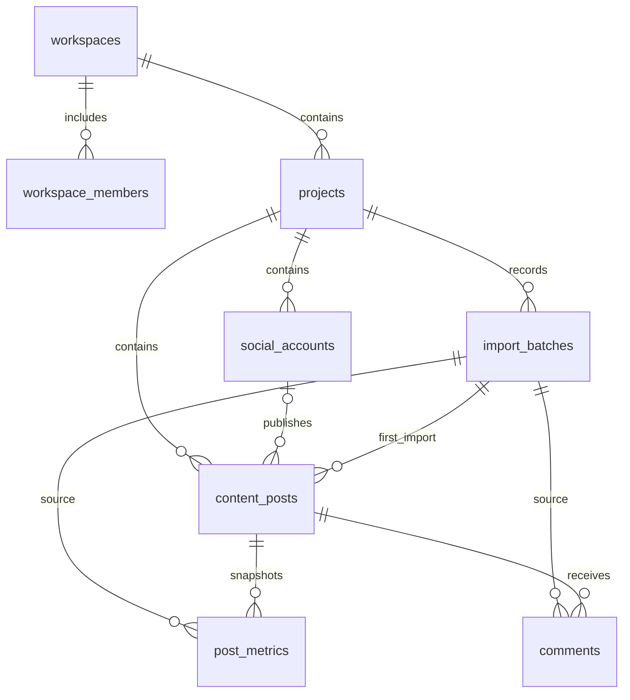

# 数据库设计与决策 V0.6

更新：2026-11-04。状态：13 张业务表已在云端创建，结构与角色权限检查通过；真实账号端到端验收留到最后。

原始 V1.0 文件是设计参考；本文记录实现方案、明确化的规则和阶段边界。
外部数据集字段、许可证、平台指标定义和模型效果均未因此获得核验。

## 表清单与阶段

| 阶段 | 表 | 一行表示什么 | 主要关系 |
|---|---|---|---|
| P0，已提供迁移 | `workspaces` | 一个团队或个人工作空间 | `owner_id → auth.users` |
| P0，已提供迁移 | `workspace_members` | 一名用户在空间内的角色 | `workspace_id → workspaces`，`user_id → auth.users` |
| P0，已提供迁移 | `projects` | 一个品牌或分析项目 | `workspace_id → workspaces` |
| P0，已提供迁移 | `social_accounts` | 项目中的一个平台账号 | `project_id → projects` |
| P0，已提供迁移 | `import_batches` | 一个文件的导入批次及来源记录 | `project_id → projects` |
| P0，已提供迁移 | `content_posts` | 一篇内容 | 项目、可选账号、首次导入批次 |
| P0，已提供迁移 | `post_metrics` | 一篇内容某时刻、某口径的快照 | 项目、内容、来源批次 |
| P0，已提供迁移 | `comments` | 一条导入的评论 | 项目、内容、来源批次 |
| P1，已实现 | `analysis_runs` | 一次可复现的分析任务 | 项目；保存输入快照、批次、筛选、源版本、处理和模型版本 |
| P1，已实现 | `analysis_results` | 一次任务生成的一项结构化统计结果 | 分析任务；记录指标、值、分母、样本量与限制 |
| P2，已实现规则初筛 | `comment_analyses` | 某任务对一条评论的整体分析 | 评论、分析任务；记录状态、方法版本、主题和命中词 |
| P2 进阶，待迁移 | `comment_aspects` | 某任务抽取的一个评论方面及情感 | 评论、分析任务；保留原文证据 |
| P3，已实现 | `insights` | 一条由统计证据支持的洞察 | 分析任务；记录观察、行动、证据和限制 |
| P4，已实现 | `reports` | 一份报告的正文和元数据 | 项目、分析任务；正文在私有数据库中保存，文件按需导出 |

Supabase Auth 负责用户身份，复用 `auth.users`，不另建保存密码的业务用户表。
`comment_aspects` 暂未建表；当前词典初筛不代表经过评估的 NLP 模型。
分析的五张表通过组合外键保持项目隔离，使用调用用户 JWT 和 SECURITY INVOKER RPC。
API 仅允许按角色读取/新增，不能修改历史结果；保存任务、结果、评论初筛、洞察和报告为同一事务。
数据库中的报告随项目级联清理。原始文件默认持续保留，所有者可手动逐批清理；未清理原文件前禁止删除项目或工作空间。

## 关系图

## 本次明确的设计规则

1. **统一 UUID。**业务表均有 UUID 主键。计数为可空 `BIGINT`，时间使用 `TIMESTAMPTZ`。
2. **内容键在项目内唯一。**原规范一处说项目内唯一，另一处建议 `(project_id, platform, content_key)`。
   P0 采用更严格的 `(project_id, content_key)`，因为 Metrics 和 Comments 仅通过 `content_key` 关联，
   没有平台字段来消除歧义。混合平台文件应使用 `youtube_post_001`、`weibo_post_001` 等稳定键。
3. **内容键应跨批次稳定。**追加指标和评论时复用项目内原内容 ID；此时只提供子表或忽略旧 Posts。新导入 Posts 遇到已有内容键会拒绝，不能自动覆盖。
   P0 不自动覆盖已有内容正文或标题；修订流程后续设计。首次来源批次保留，后续完整原始工作簿仍按批次保存。
4. **快照独立保存。**唯一键为 `(content_post_id, snapshot_time, snapshot_type, metric_profile)`。
   同批次重复提交返回原结果；不同批次遇到同一快照均报告冲突并整批回滚，不自动覆盖或跳过。
5. **P0 仅接受累计快照。**`snapshot_type` 固定为 `cumulative`；周期快照需要起止边界，暂不接受 `period`。
6. **NULL 与 0 分开。**计数无默认零，负数拒绝；平台特殊缺失码先转为 NULL，并在 `missing_reasons` 记录原因。
7. **关联必须属于同一项目。**指标、评论、账号和来源批次采用带 `project_id` 的组合外键，
   即使用户同时有两个项目的访问权限，也不能把 A 项目的评论挂在 B 项目的内容上。账号平台也必须与内容平台一致。
8. **评论推断指纹不强制唯一。**平台评论 ID 在同一内容下唯一；文件评论键仅在同一批次内唯一；
   指纹只用于疑似重复复核。不同用户的相同文本不得因此被自动删除。
9. **同批次重复提交有数据库兜底。**三类导入行都有 `(source_batch_id, source_row_number)` 唯一约束，行号按各自 Sheet 计数。
   已实现 SECURITY INVOKER RPC，按项目、批次加锁后单事务写入。数据库和服务层验证已通过，真实账号端到端验收仍待完成。
10. **文件哈希用于识别重复，不做唯一约束。**同文件可以因映射调整重新校验；跨批次由业务键、快照键和平台评论 ID 判断重复。
    无稳定 ID 的评论跨批次仅标记疑似重复，不能保证自动判重。
11. **来源默认保守。**许可证默认 `unknown`、未核验，公开演示默认关闭；只有完成许可证核验后才允许开启演示标记。
    这项约束不等于替代人工授权核查。
12. **原始文件已接入私有存储。**`import_batches.file_manifest` 保存最多三个文件，`import_config` 保存映射与编码；`request_hash` 在项目的保留中或已成功批次内唯一。
    一批合计上限 20 MiB；服务器重新读取文件、核对 SHA-256、内容结构与扩展名，不只信任 MIME。

## 权限

| 操作 | owner | editor | viewer | 未登录或非成员 |
|---|---|---|---|---|
| 读取空间内项目与数据 | 允许 | 允许 | 允许 | 拒绝 |
| 创建项目、编辑项目数据 | 允许 | 允许 | 拒绝 | 拒绝 |
| 删除项目 | 允许 | 拒绝 | 拒绝 | 拒绝 |
| 重命名或删除工作空间 | 允许 | 拒绝 | 拒绝 | 拒绝 |
| 添加/移除成员、调整 editor/viewer | 允许 | 拒绝 | 拒绝 | 拒绝 |
| 转移工作空间所有权 | 暂未实现 | 拒绝 | 拒绝 | 拒绝 |

创建工作空间时由触发器写入 owner 成员。成员表的权限检查通过 `private` 模式中的函数进行，避免递归 RLS。
`private` 不能加入 Supabase 的 Exposed schemas。辅助函数固定空 `search_path`，仅向 authenticated 授予必要执行权限。
业务表全部启用 RLS。当前客户端通过用户会话访问，未额外授予 `service_role` 业务表权限。
后续如需要高权限后端作业，须另行审查并明确授权；后端接口仍必须验证用户与项目归属。

## 删除与可追溯性

删除项目会级联删除其数据库业务数据；操作前必须先通过原文件清理流程，数据库会阻止未清理文件的项目/空间删除。
已被业务记录引用的导入批次不能单独删除。当前没有删除项目/空间页面入口。
原始文件默认持续保留，手动清理及所有者权限已部署；脱敏、完整个人数据删除和真实账号 HTTP 全流程仍需验收。

## 验证边界与依据

本地验证使用 PGlite 的 PostgreSQL 引擎，模拟 Supabase Auth，执行实际迁移文件。
覆盖工作空间隔离、非 owner 成员读取、角色写权限、跨项目外键、NULL、快照与评论去重及级联删除。
云端已用事务内合成用户验证实际 PostgreSQL 角色、`auth.uid()` 和 RLS，测试数据全部回滚。
这不是完整的用户登录测试。第三部分已增加云端导入事务和 Storage 策略检查（合成夹具全部回滚）；真实登录、实际文件上传与下载仍需验收。

- [Supabase：Row Level Security](https://supabase.com/docs/guides/database/postgres/row-level-security)
- [Supabase：数据库迁移](https://supabase.com/docs/guides/local-development/database-migrations)
- [PGlite：文档](https://pglite.dev/docs/)

## 原文件生命周期（V0.6）

`import_batches` 新增 `originals_state`（retained/deleting/deleted）、开始时间、操作者和完成时间；状态不可回退。
`begin_original_cleanup` / `finish_original_cleanup` 均为 SECURITY INVOKER，只允许空间所有者操作；清理路径来自固定批次清单。
物理删除通过用户 JWT 下的 Storage API `remove`，SQL 不删除 Storage 元数据。只有 deleting 批次的清单路径可删除。
上传策略使用批次共享锁，清理和入库使用项目/批次锁；清理后禁止旧批次写入或重新上传，完成前核对文件已不存在。
成功批次的导入指纹继续去重；未成功且已开始清理的批次不再占用指纹，新上传建立新批次，旧来源记录保留。
项目、工作空间、批次删除之前检查清理状态，避免级联删除先移除文件归属。页面尚不提供删除项目/空间入口。
默认不设自动保留天数或定时清理；团队按实际授权自行决定何时手动清理。完整个人数据删除必须同时覆盖数据库、分析快照和导出副本。
