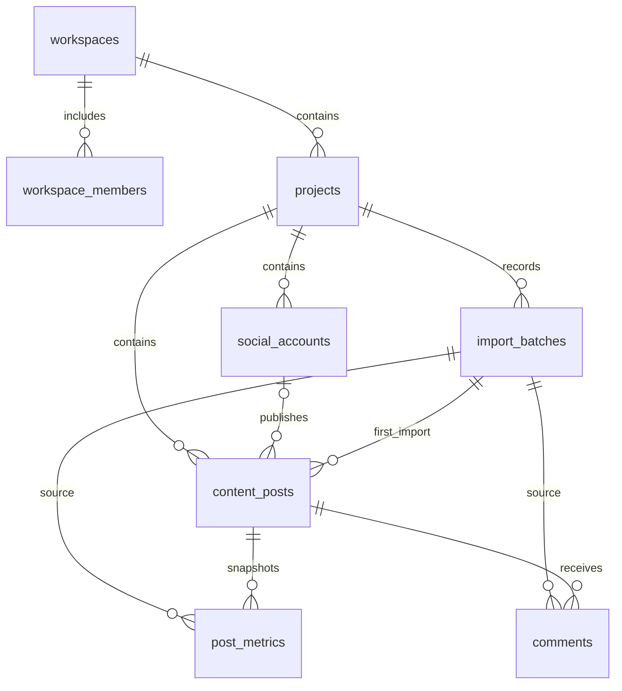

# 数据库设计与决策 V0.1

日期：2026-11-02。状态：P0 的 8 张表已在云端创建，结构与角色权限检查通过。

原始 V1.0 文件是设计参考；本文记录实现方案、明确化的规则和阶段边界。
外部数据集字段、许可证、平台指标定义和模型效果均未因此获得核验。

## 表清单与阶段

| 阶段 | 表 | 一行表示什么 | 主要关系 |
|---|---|---|---|
| P0，已提供迁移 | `workspaces` | 一个团队或个人工作空间 | `owner_id → auth.users` |
| P0，已提供迁移 | `workspace_members` | 一名用户在空间内的角色 | `workspace_id → workspaces`，`user_id → auth.users` |
| P0，已提供迁移 | `projects` | 一个品牌或分析项目 | `workspace_id → workspaces` |
| P0，已提供迁移 | `social_accounts` | 项目中的一个平台账号 | `project_id → projects` |
| P0，已提供迁移 | `import_batches` | 一个文件的导入批次及来源记录 | `project_id → projects` |
| P0，已提供迁移 | `content_posts` | 一篇内容 | 项目、可选账号、首次导入批次 |
| P0，已提供迁移 | `post_metrics` | 一篇内容某时刻、某口径的快照 | 项目、内容、来源批次 |
| P0，已提供迁移 | `comments` | 一条导入的评论 | 项目、内容、来源批次 |
| P1，待迁移 | `analysis_runs` | 一次可复现的分析任务 | 项目；记录输入批次、数据范围、数据/代码/口径/模型版本 |
| P1，待迁移 | `analysis_results` | 一次任务生成的一项结构化统计结果 | 分析任务；记录指标、值、分母、样本量与限制 |
| P2，待迁移 | `comment_analyses` | 某任务对一条评论的整体分析 | 评论、分析任务；记录状态与模型版本 |
| P2 进阶，待迁移 | `comment_aspects` | 某任务抽取的一个评论方面及情感 | 评论、分析任务；保留原文证据 |
| P3，待迁移 | `insights` | 一条由统计证据支持的洞察 | 分析任务、证据结果；记录生成模型版本 |
| P4，待迁移 | `reports` | 一份导出报告的元数据 | 项目、分析任务、私有文件位置 |

Supabase Auth 负责用户身份，复用 `auth.users`，不另建保存密码的业务用户表。
后续 6 张表尚无字段级迁移，也尚未实现对应功能。

## 关系图

## 本次明确的设计规则

1. **统一 UUID。**业务表均有 UUID 主键。计数为可空 `BIGINT`，时间使用 `TIMESTAMPTZ`。
2. **内容键在项目内唯一。**原规范一处说项目内唯一，另一处建议 `(project_id, platform, content_key)`。
   P0 采用更严格的 `(project_id, content_key)`，因为 Metrics 和 Comments 仅通过 `content_key` 关联，
   没有平台字段来消除歧义。混合平台文件应使用 `youtube_post_001`、`weibo_post_001` 等稳定键。
3. **内容键应跨批次稳定。**新批次遇到已有内容键时复用内容 ID，追加指标和评论；不同外部内容 ID 的冲突进入错误报告。
   P0 不自动覆盖已有内容正文或标题；修订流程后续设计。首次来源批次保留，后续完整原始工作簿仍按批次保存。
4. **快照独立保存。**唯一键为 `(content_post_id, snapshot_time, snapshot_type, metric_profile)`。
   同一快照重复上传时由导入服务比较记录，一致则计为重复，不一致则报告冲突，不自动覆盖。
5. **P0 仅接受累计快照。**`snapshot_type` 固定为 `cumulative`；周期快照需要起止边界，暂不接受 `period`。
6. **NULL 与 0 分开。**计数无默认零，负数拒绝；平台特殊缺失码先转为 NULL，并在 `missing_reasons` 记录原因。
7. **关联必须属于同一项目。**指标、评论、账号和来源批次采用带 `project_id` 的组合外键，
   即使用户同时有两个项目的访问权限，也不能把 A 项目的评论挂在 B 项目的内容上。账号平台也必须与内容平台一致。
8. **评论推断指纹不强制唯一。**平台评论 ID 在同一内容下唯一；文件评论键仅在同一批次内唯一；
   指纹只用于疑似重复复核。不同用户的相同文本不得因此被自动删除。
9. **同批次重复提交有数据库兜底。**三类导入行都有 `(source_batch_id, source_row_number)` 唯一约束，行号按各自 Sheet 计数。
   导入服务仍需锁定批次，在单个事务内写入并更新状态；目前尚未实现这个服务，因此不能宣称端到端幂等已经完成。
10. **文件哈希用于识别重复，不做唯一约束。**同文件可以因映射调整重新校验；跨批次由业务键、快照键和平台评论 ID 判断重复。
    无稳定 ID 的评论跨批次仅标记疑似重复，不能保证自动判重。
11. **来源默认保守。**许可证默认 `unknown`、未核验，公开演示默认关闭；只有完成许可证核验后才允许开启演示标记。
    这项约束不等于替代人工授权核查。
12. **原始文件尚未接入。**`import_batches` 已预留私有文件路径、SHA-256、大小、MIME、映射与质量报告字段。
    20 MiB 是当前方案的可调整上限，上传接口仍需校验文件内容与扩展名，不能只信任 MIME。

## 权限

| 操作 | owner | editor | viewer | 未登录或非成员 |
|---|---|---|---|---|
| 读取空间内项目与数据 | 允许 | 允许 | 允许 | 拒绝 |
| 创建项目、编辑项目数据 | 允许 | 允许 | 拒绝 | 拒绝 |
| 删除项目 | 允许 | 拒绝 | 拒绝 | 拒绝 |
| 重命名或删除工作空间 | 允许 | 拒绝 | 拒绝 | 拒绝 |
| 添加/移除成员、调整 editor/viewer | 允许 | 拒绝 | 拒绝 | 拒绝 |
| 转移工作空间所有权 | 暂未实现 | 拒绝 | 拒绝 | 拒绝 |

创建工作空间时由触发器写入 owner 成员。成员表的权限检查通过 `private` 模式中的函数进行，避免递归 RLS。
`private` 不能加入 Supabase 的 Exposed schemas。辅助函数固定空 `search_path`，仅向 authenticated 授予必要执行权限。
业务表全部启用 RLS。当前客户端通过用户会话访问，未额外授予 `service_role` 业务表权限。
后续如需要高权限后端作业，须另行审查并明确授权；后端接口仍必须验证用户与项目归属。

## 删除与可追溯性

删除项目会级联删除其数据库业务数据，但不会自动删除 Storage 文件。
已被业务记录引用的导入批次不能单独删除。项目删除服务须处理私有文件与业务记录的一致清理。
原始文件保留期限、脱敏、批次提交接口、Storage 权限和云端联调仍属待实现事项。

## 验证边界与依据

本地验证使用 PGlite 的 PostgreSQL 引擎，模拟 Supabase Auth，执行实际迁移文件。
覆盖工作空间隔离、非 owner 成员读取、角色写权限、跨项目外键、NULL、快照与评论去重及级联删除。
云端已用事务内合成用户验证实际 PostgreSQL 角色、`auth.uid()` 和 RLS，测试数据全部回滚。
这不是完整的用户登录测试。Storage、真实登录后的 Data API 和文件导入将在应用阶段联调。

- [Supabase：Row Level Security](https://supabase.com/docs/guides/database/postgres/row-level-security)
- [Supabase：数据库迁移](https://supabase.com/docs/guides/local-development/database-migrations)
- [PGlite：文档](https://pglite.dev/docs/)
